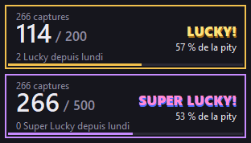

# Compteur pity Aniimo

Petite fenêtre toujours au-dessus du jeu qui **compte toute seule vos captures** dans Aniimo et suit la garantie (pity) des **Coups de chance (Lucky)** et des **Super Lucky**. Un bandeau optionnel suit aussi l'**énergie prismatique** des Floraisons.

**[Télécharger](https://github.com/Zanpil/compteur-pity-aniimo/releases/latest)** · **[Page du projet](https://zanpil.github.io/compteur-pity-aniimo/)** · **[Nouveautés](CHANGELOG.md)**

 

> **Outil non officiel**, sans lien avec NetEase. Il ne lit ni la mémoire ni le réseau du jeu et ne modifie aucun fichier : il regarde une petite zone de l'écran et reçoit le son d'Aniimo par Windows, comme le font OBS ou Discord. Les conditions d'utilisation du jeu peuvent interdire les outils tiers : vous l'utilisez à vos risques.

## Ce qu'il fait

- **Captures comptées automatiquement** : chaque Aniimo capturé fait apparaître sa carte à gauche de l'écran (« Jebond / Niv. 52 »). Le compteur en lit l'arrivée, captures de groupe comprises. Il compte aussi les portraits d'une capture de masse au **Culbuton**.
- **Lucky et Super Lucky reconnus au son** : le compteur n'écoute que le jeu (pas Discord, un live ou la musique) et reconnaît le son « Lucky! » et « Super Lucky! ».
- **Pity** : pour chaque type de coup, les captures depuis le dernier (x / y, où y est la capture garantie), le pourcentage de la garantie, et le nombre obtenu depuis lundi. Le clic droit donne la chance par capture, la moyenne restante et le temps avant le reset.
- **Bandeau Floraison** : ouvrez le menu Enrichir d'une zone, et le bandeau affiche son énergie prismatique, ce qui manque pour qu'elle soit pleine (un Aniimo prismana apparaît alors à coup sûr), et combien de Lucky ou de Super Lucky ça représente.

## Installer

1. Téléchargez **`Compteur-pity-Aniimo.zip`** dans les [téléchargements](https://github.com/Zanpil/compteur-pity-aniimo/releases/latest) et dézippez-le dans un dossier à vous. Le compteur y crée `config.json` et `data\`.
2. Double-cliquez sur **`Compteur pity Aniimo.exe`**. Si Windows affiche « Windows a protégé votre ordinateur » (le programme n'est pas signé) : *Informations complémentaires* > *Exécuter quand même*.
3. Si vous avez déjà capturé depuis lundi : clic droit sur le compteur > *Régler les compteurs…*

Il faut :
- **Windows 10** (version 2004 ou plus récente) ou **Windows 11** ;
- le jeu en **plein écran fenêtré** ou **fenêtré**, pas en plein écran exclusif ;
- le jeu **en français**, car le compteur lit « Niv. » et des titres de menu ;
- les **effets sonores** du jeu activés.

Il a été réglé en 2560×1440. Les autres résolutions en 16:9 sont mises à l'échelle et devraient marcher.

Si rien ne se compte : double-cliquez sur **`Tester le compteur.bat`**, jeu ouvert. Il vérifie le son, l'écran et les fichiers, et écrit le résultat dans `test.txt`.

## Utiliser

Normalement, rien à faire : chaque capture fait +1 et le nombre s'allume en vert. Le cadre s'allume en doré pour un Lucky, en rose pour un Super Lucky. Les touches servent seulement à corriger :

| Touche par défaut | Action |
|---|---|
| F7 | une capture qu'il n'a pas comptée |
| F8 | un Lucky qu'il n'a pas reconnu |
| F9 | un Super Lucky qu'il n'a pas reconnu |
| F6 | annuler la dernière action, y compris une détection automatique |

Une touche appuyée juste après une détection automatique est absorbée : pas de double comptage.

**Tant que le compteur tourne, ses touches ne vont plus au jeu.** Or le jeu utilise F7 (appareil photo), F8 (photo rapide) et F9. Changez-les dans les réglages, par exemple pour le pavé numérique ou Ctrl + F7.

- **La bulle** (le logo) : un clic ouvre le **menu**, qui reste ouvert jusqu'à ce que vous le fermiez (✕, Échap, la bulle à nouveau). Le clic droit sur un panneau ouvre le même menu. On y trouve les détails, les corrections, les zones Floraison lues, *Régler les compteurs…*, *Réglages…* et *Quitter*.
- **Glisser un panneau** : le déplacer seul. **Maj + glisser** : déplacer tous les panneaux ensemble. Approché d'un autre panneau ou d'un bord de l'écran, il s'aimante.
- **Menu > Panneaux** : chaque panneau se **verrouille** (il ne bouge plus) et se **lie** aux autres (les panneaux liés se déplacent ensemble).
- **Ctrl + molette** sur un panneau : l'agrandir ou le rétrécir (60 à 160 %), ou par les réglages.

### Réglages

Clic droit sur le compteur ou sur le bandeau > **Réglages…**. Les changements s'appliquent tout de suite.

- **Afficher** : le panneau Lucky, le panneau Super Lucky, le panneau Floraison, la bulle, et l'opacité. Un au moins reste affiché, pour garder l'accès au menu.
- **Taille de chaque panneau** : Lucky, Super Lucky, Floraison et bulle, de 60 à 160 %.
- **Touches de correction** : cliquez sur une action puis appuyez sur la nouvelle touche. Une touche seule du pavé numérique, une touche F, ou une combinaison avec Ctrl, Alt ou Maj. Échap annule, *Aucune* retire la touche.
- **Serveur** : Europe, Amérique ou Asie, pour l'heure du reset du lundi.

### Panneau Floraison

Ouvrez le menu **Enrichir** d'une Floraison et cliquez sur une zone. Le compteur lit son nom, son état et la barre, puis calcule les points. Chaque zone lue est retenue : clic droit sur le bandeau pour revoir les autres.

L'encadré « Restant » donne les points manquants, et leur équivalent en Lucky, en Super Lucky et en **Floraisons** (enrichissements). Les Lucky obtenus ensuite sont ajoutés avec leur gain moyen (« ≈ ») jusqu'à la lecture suivante. Le gain du fruit de veine n'est pas compté : rouvrez le menu après l'avoir cueilli.

Le compteur se cache des captures d'écran (et du partage Discord) seulement quand il est posé sur une zone qu'il lit, pour ne pas se la cacher à lui-même. Ailleurs, on le voit normalement.

## Règles utilisées

Toutes viennent des fichiers du jeu (`Data/formula_data.lua`, tables `area_rainbowPet_level_data`), et elles correspondent aux chiffres de la page « Probability Details » du jeu.

| | Déjà eus cette semaine | Chance par capture | Garanti à |
|---|---|---|---|
| Lucky | 0 à 9 | 1 % | 200 |
| Lucky | 10 et plus | 0,5 % | 400 |
| Super Lucky | 0 | 0,2 % | 500 |
| Super Lucky | 1 | 0,1 % | 1 000 |
| Super Lucky | 2 et plus | 0,05 % | 3 000 |

- Le Super Lucky est tiré en premier. Reset le lundi à 04:00, heure du serveur (04:00 UTC en Europe) : les compteurs de la semaine et de garantie repartent à 0.
- **Énergie prismatique d'une zone** : Vide 0, Très faible 501, Léger 1 501, Abondant 3 001, Très élevé 6 001, **Plein 10 500** (Aniimo prismana garanti).
- Un **Lucky** ajoute 275 points (40 % des fois), 300 (50 %), 350 (5 %) ou 500 (5 %), soit **302,5 en moyenne**. Un **Super Lucky** ajoute **1 500** points. Chaque gain a 3 % de chances de remplir la zone d'un coup.
- Un **enrichissement** (une Floraison dont on cueille le fruit de veine) donne environ **480 points**, 720 pendant les événements d'abondance de la Veine. Ce gain est calculé par le serveur : le chiffre vient d'un guide de la communauté. Ses chiffres pour les Lucky (275 à 500) sont exacts, et il colle avec les effets que le jeu joue à la cueillette (plus gros à partir de 500, 600 et 700 points). Si vos mesures diffèrent, changez `"floraison_gain"` dans `config.json`.
- Le menu Enrichir montre l'avancement **dans l'état actuel** : (énergie − seuil de l'état) ÷ (seuil suivant − seuil de l'état).

## Comment il détecte

- **Cartes de capture** : une nouvelle carte apparaît en bas de la pile, d'abord en bulle gris clair pendant 0,1 s, puis avec son texte. Le compteur copie ce coin de l'écran 30 fois par seconde. Il compte une carte quand une bulle claire apparaît à une place de la pile, puis qu'un nouveau « Niv. » devient lisible à cet endroit. Il suit chaque « Niv. » d'une image à l'autre, pour ne pas recompter une carte qui remonte dans la pile.
- **Culbuton** : il repère le titre « Capturer avec un Culbuton » et compte les cases de la grille (portrait au-dessus d'un badge de niveau).
- **Lucky / Super Lucky** : il reçoit le son d'Aniimo seul, par la capture audio d'application de Windows (Windows 10 2004+). Il le compare 4 fois par seconde aux **empreintes** des sons du jeu : leur spectre en 64 bandes de fréquences, toutes les 10 ms. Les empreintes (`sons/empreintes.npz`) ne contiennent pas les sons et ne peuvent pas être réécoutées.
- **Floraison** : il repère le titre du menu Enrichir, mesure la barre et lit les noms avec la reconnaissance de texte de Windows (OcrEngine, la même que l'outil Capture d'écran).

Testé sur trois vidéos de captures : des captures simples, des captures de groupe à l'Aniipod méga, et des rafales avec un Culbuton. Il y trouve 31, 63 et 66 cartes, plus les 10 Aniimo du Culbuton. Dans les passages vérifiés image par image, il n'a ni compté de carte en trop ni oublié de carte.

## Depuis les sources

Python 3.12 avec `numpy` et `opencv-python` :

```
pip install numpy opencv-python
pythonw overlay.py
```

- `Construire le programme.bat` fabrique l'exe avec PyInstaller (`pip install pyinstaller`).
- `python overlay.py --test` lance la vérification.
- `Préparer les sons.bat` réextrait les sons du jeu dans `sons/`, depuis votre installation d'Aniimo (`tools/extract_sounds.py <dossier du jeu>`). Il faut [vgmstream-cli](https://github.com/vgmstream/vgmstream/releases) dans `tools/vgmstream/`. Ensuite, `python detect.py --empreintes` refait les empreintes. Ce n'est utile qu'après une mise à jour du jeu qui changerait les sons.

| Fichier | Rôle |
|---|---|
| `overlay.py` | les panneaux (une fenêtre chacun), le menu, les réglages, les touches |
| `theme.py` | le dessin des panneaux |
| `pity.py` | les règles de garantie, les compteurs recalculés depuis l'historique |
| `cards.py` | les cartes de capture et le Culbuton, à l'écran |
| `detect.py`, `game_audio.py` | la reconnaissance des sons, la réception du son du jeu seul |
| `floraison.py` | la lecture du menu Enrichir et les règles de l'énergie prismatique |
| `sons/empreintes.npz`, `images/` | les empreintes des sons et trois petits modèles d'image (« Niv. », deux titres) |
| `data/events.jsonl` | chez vous : l'historique de vos captures, à sauvegarder |

## Licence

Le code est sous licence MIT (voir `LICENSE`). Aniimo, ses noms, sons et images appartiennent à NetEase. Le dépôt ne contient que les empreintes de trois sons et trois petits bouts d'interface, qui servent de modèles de détection.
